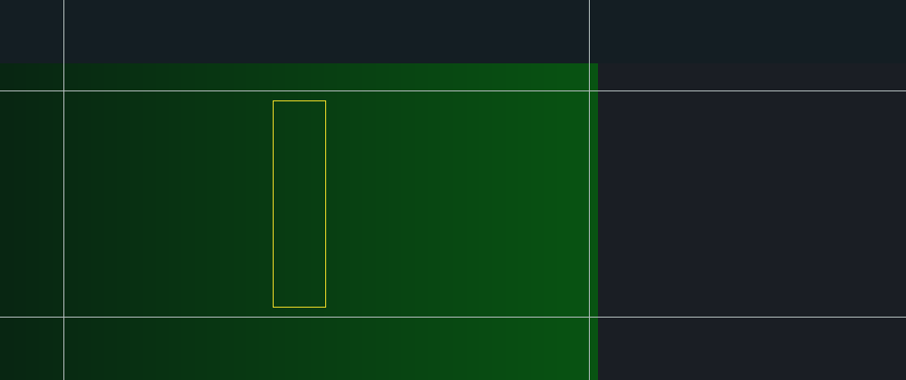

# Header with one Hash
## Header with two Hashes
### Header with three Hashes

---

Your specific tasks are to:
   - Select contacts displayed in the lower BTH waterfall window.
   - Classify the signal that appears in the upper LOFAR frequency waterfall window by choosing appropriate classification (vessels, submarine, or biologics) and clicking **Confirm**.
   - Choose confidence level for each classification.
   - During Orientation and Practice blocks, utilize Training Instructions for better understanding of the different vessel signals/frequencies.

> Note that while you get to learn typical signals from each category during the orientation and practice blocks, the contacts you will encounter throughout the experiment will all have slightly different signals.

---

Following is a list with dashes '-'
- First Item
- Second Item
- Third Item

Numbered List:
1. First
2. Second
3. Third

Quote, shown as an indented, lighter line.
> Quote, shown as an indented, lighter line.

Inline emphasis, **bold**, *italic*, `code`

{width=70% align=center}

# Basic Contact Classification

This package is included as a **test experiment** for the SONAR Simulator Task.

## Workflow

1. Press **Start** to begin the first phase.
2. Select a bearing region in the BTH by clicking the contact.
3. Inspect the LOFAR frequency history for the selected bearing aperture.
4. Choose a classification, press **Confirm**, then choose confidence **1–4**.
5. If the experiment automatically pauses between phases, press **Resume**.

> The generated audio in this sample package is synthetic test material, not a calibrated or operational sonar recording.

## Confidence

- **1** — low confidence
- **2** — somewhat confident
- **3** — confident
- **4** — high confidence
